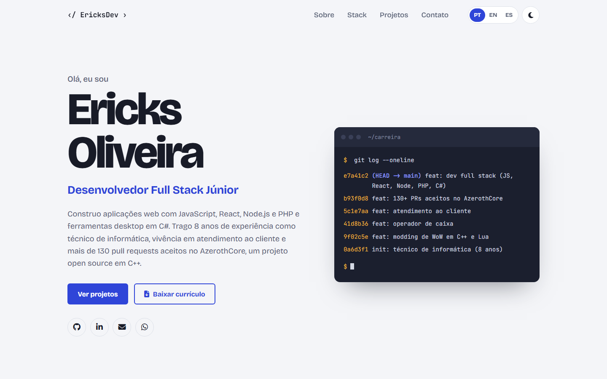

<p align="center">
  <a href="README.md">Português</a> · <strong>English</strong> · <a href="README.es.md">Español</a>
</p>

<h1 align="center">Portfolio | Ericks Oliveira</h1>

<p align="center">
  Personal website with my career path, stack, projects and contact details.<br>
  Built with plain HTML, CSS and JavaScript, in three languages, with light and dark themes.
</p>

<p align="center">
  <a href="https://ericksoliveira.github.io/portfolio/"><strong>Visit the website »</strong></a>
</p>

<p align="center">
  
  
  
  
  
</p>

<p align="center">
  <picture>
    <source media="(prefers-color-scheme: dark)" srcset="img/readme/dark.png">
    
  </picture>
</p>

## Contents

- [About me](#about-me)
- [Site highlights](#site-highlights)
- [Featured projects](#featured-projects)
- [Technologies](#technologies)
- [Accessibility](#accessibility)
- [Project structure](#project-structure)
- [Running locally](#running-locally)
- [Editing texts and translations](#editing-texts-and-translations)
- [Contact](#contact)

## About me

I'm a Junior Full Stack Developer changing careers, with 8 years of experience as an IT technician and a background in customer service. I build web applications with JavaScript, React, Node.js and PHP, and desktop tools in C#.

I contribute to [AzerothCore](https://github.com/azerothcore/azerothcore-wotlk), an open source World of Warcraft emulator written in C++, where I've had **more than 130 pull requests merged**.

## Site highlights

- **Career path as a `git log`:** at the top of the page, my career is shown as a commit history in a terminal.
- **Three languages:** Portuguese, English and Spanish, switched instantly without reloading the page. The chosen language is saved in the browser.
- **Resume per language:** the "Download CV" button gives you the PDF in the language shown on screen.
- **Light and dark themes:** follows the system preference and can be switched with a button. The choice is saved too.
- **Contact form:** sends an email through [FormSubmit](https://formsubmit.co/) and tells me which language the visitor wrote in.
- **Responsive:** layout designed for phones, tablets and desktops, with its own menu for small screens.
- **Link previews:** Open Graph and Twitter Card meta tags, so the link shows a photo and description on LinkedIn and WhatsApp.

## Featured projects

| Project | What it is | Technologies |
| --- | --- | --- |
| [AzerothCore](https://github.com/azerothcore/azerothcore-wotlk/pulls?q=is%3Apr+is%3Amerged+author%3AEricksOliveira) | More than 130 PRs merged into the official emulator, fixing spells, combat, raid bosses and game data | C++, SQL, Lua |
| [Trading Bot](https://github.com/EricksOliveira/robo-trader) | Trading bot for Binance with a dashboard, backtesting and strategies. Runs on the testnet | Python, pandas, JavaScript |
| [AzerothCore CPanel](https://github.com/EricksOliveira/AzerothCore-CPanel) | Windows panel that controls an AzerothCore server, shows live logs and backs up the database | C#, WPF, .NET 8, MySQL |
| [mod-killstrike](https://github.com/EricksOliveira/mod-killstrike) | Module that counts PvP kill streaks, announces milestones and gives rewards | C++, SQL |
| [mod-playerbots](https://github.com/liyunfan1223/mod-playerbots) | Module that adds bots that behave like real players | C++ |

My other projects are on [my GitHub](https://github.com/EricksOliveira?tab=repositories).

## Technologies

| Area | Use on the site |
| --- | --- |
| HTML5 | Semantic markup, SEO meta tags and social media previews |
| CSS3 | Variables for the themes, Grid, Flexbox and media queries |
| JavaScript | Plain, with no frameworks or libraries: theme, menu, translations and active navigation |
| Fonts and icons | [Bricolage Grotesque and JetBrains Mono](https://fonts.google.com/) and [Font Awesome](https://fontawesome.com/) |
| Form | [FormSubmit](https://formsubmit.co/) |
| Hosting | [GitHub Pages](https://pages.github.com/) |

## Accessibility

- Full keyboard navigation, with visible focus and the <kbd>Esc</kbd> key to close the menu
- Alternative text on images, also translated
- Labels on every form field and `aria-label` on icon buttons
- Respects the system preference for dark mode and reduced motion

## Project structure

```text
portfolio/
├── index.html      # Single page, with the texts in Portuguese
├── css/
│   └── style.css   # Styles, light and dark themes and responsive layout
├── js/
│   ├── main.js     # Theme, mobile menu and active link in the navigation
│   └── i18n.js     # English and Spanish translations
├── img/            # Photos, project images and README screenshots
└── curriculo/      # Resume as PDF (PT, EN and ES)
```

## Running locally

The site needs no build step and no dependencies.

```bash
git clone https://github.com/EricksOliveira/portfolio.git
cd portfolio
```

Then open `index.html` in your browser. If you prefer a local server, use one of these options:

```bash
# Python
python -m http.server 8000

# Node.js
npx serve .
```

And go to `http://localhost:8000` (or the address shown by `serve`). The Live Server extension for VS Code also works.

## Editing texts and translations

- **Portuguese** is the default language and is written directly in `index.html`.
- **English** and **Spanish** live in `js/i18n.js`.
- Each translatable text has a `data-i18n="key"` attribute in the HTML. For attributes such as `alt` and `aria-label`, use `data-i18n-attr="alt:key"`.
- To translate a new text, add the attribute to the element and add the same key to the `en` and `es` blocks in `i18n.js`.

## Contact

- LinkedIn: [linkedin.com/in/ericksoliveira](https://www.linkedin.com/in/ericksoliveira)
- Email: ericksoliveira258@gmail.com
- GitHub: [@EricksOliveira](https://github.com/EricksOliveira)
