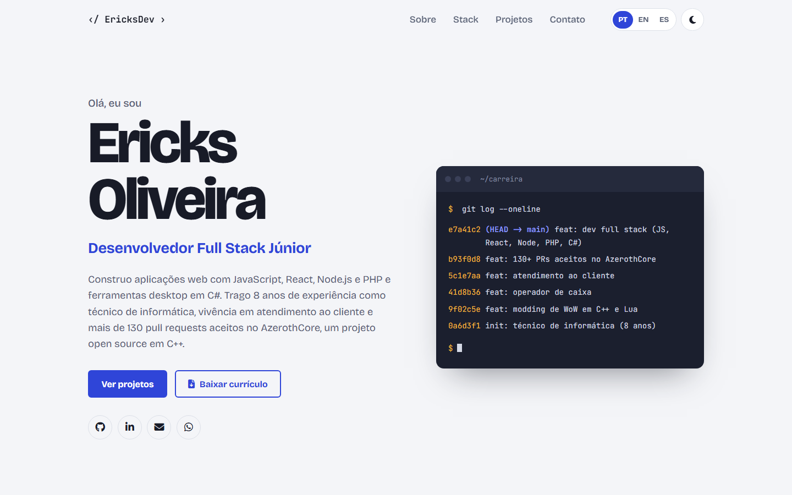

<p align="center">
  <a href="README.md">Português</a> · <a href="README.en.md">English</a> · <strong>Español</strong>
</p>

<h1 align="center">Portafolio | Ericks Oliveira</h1>

<p align="center">
  Sitio personal con mi trayectoria, stack, proyectos y formas de contacto.<br>
  Hecho con HTML, CSS y JavaScript puros, en tres idiomas y con tema claro y oscuro.
</p>

<p align="center">
  <a href="https://ericksoliveira.github.io/portfolio/"><strong>Visitar el sitio »</strong></a>
</p>

<p align="center">
  
  
  
  
  
</p>

<p align="center">
  <picture>
    <source media="(prefers-color-scheme: dark)" srcset="img/readme/dark.png">
    
  </picture>
</p>

## Índice

- [Sobre mí](#sobre-mí)
- [Destacados del sitio](#destacados-del-sitio)
- [Proyectos destacados](#proyectos-destacados)
- [Tecnologías](#tecnologías)
- [Accesibilidad](#accesibilidad)
- [Estructura del proyecto](#estructura-del-proyecto)
- [Cómo ejecutarlo localmente](#cómo-ejecutarlo-localmente)
- [Cómo editar textos y traducciones](#cómo-editar-textos-y-traducciones)
- [Contacto](#contacto)

## Sobre mí

Soy desarrollador Full Stack Junior en transición de carrera, con 8 años de experiencia como técnico de informática y experiencia en atención al cliente. Construyo aplicaciones web con JavaScript, React, Node.js y PHP, y herramientas de escritorio en C#.

Contribuyo con [AzerothCore](https://github.com/azerothcore/azerothcore-wotlk), un emulador open source de World of Warcraft en C++, donde ya tengo **más de 130 pull requests aceptados**.

## Destacados del sitio

- **Trayectoria como `git log`:** en la parte superior de la página, mi carrera aparece como un historial de commits en una terminal.
- **Tres idiomas:** portugués, inglés y español, que se cambian al instante sin recargar la página. El idioma elegido queda guardado en el navegador.
- **CV por idioma:** el botón "Descargar CV" entrega el PDF en el idioma que está en pantalla.
- **Tema claro y oscuro:** sigue la preferencia del sistema y se puede cambiar con un botón. La elección también queda guardada.
- **Formulario de contacto:** envía un correo a través de [FormSubmit](https://formsubmit.co/) e indica en qué idioma escribió la persona.
- **Responsivo:** diseño pensado para celular, tableta y escritorio, con un menú propio para pantallas pequeñas.
- **Vista previa al compartir:** metaetiquetas Open Graph y Twitter Card para que el enlace aparezca con foto y descripción en LinkedIn y WhatsApp.

## Proyectos destacados

| Proyecto | Qué es | Tecnologías |
| --- | --- | --- |
| [AzerothCore](https://github.com/azerothcore/azerothcore-wotlk/pulls?q=is%3Apr+is%3Amerged+author%3AEricksOliveira) | Más de 130 PRs aceptados en el emulador oficial, corrigiendo hechizos, combate, jefes de banda y datos del juego | C++, SQL, Lua |
| [Robot de Trading](https://github.com/EricksOliveira/robo-trader) | Robot de trading para Binance con panel, backtest y estrategias. Funciona en la testnet | Python, pandas, JavaScript |
| [AzerothCore CPanel](https://github.com/EricksOliveira/AzerothCore-CPanel) | Panel para Windows que controla un servidor AzerothCore, muestra logs en vivo y hace copias de seguridad | C#, WPF, .NET 8, MySQL |
| [mod-killstrike](https://github.com/EricksOliveira/mod-killstrike) | Módulo que cuenta rachas de muertes en PvP, anuncia logros y da recompensas | C++, SQL |
| [mod-playerbots](https://github.com/liyunfan1223/mod-playerbots) | Módulo que añade bots con comportamiento de jugadores reales | C++ |

Mis otros proyectos están en [mi GitHub](https://github.com/EricksOliveira?tab=repositories).

## Tecnologías

| Área | Uso en el sitio |
| --- | --- |
| HTML5 | Marcado semántico, metaetiquetas de SEO y vista previa en redes sociales |
| CSS3 | Variables para los temas, Grid, Flexbox y media queries |
| JavaScript | Puro, sin frameworks ni bibliotecas: tema, menú, traducciones y navegación activa |
| Fuentes e íconos | [Bricolage Grotesque y JetBrains Mono](https://fonts.google.com/) y [Font Awesome](https://fontawesome.com/) |
| Formulario | [FormSubmit](https://formsubmit.co/) |
| Hosting | [GitHub Pages](https://pages.github.com/) |

## Accesibilidad

- Navegación completa con teclado, con foco visible y la tecla <kbd>Esc</kbd> para cerrar el menú
- Textos alternativos en las imágenes, también traducidos
- Etiquetas en todos los campos del formulario y `aria-label` en los botones de ícono
- Respeta la preferencia del sistema por tema oscuro y por menos animaciones

## Estructura del proyecto

```text
portfolio/
├── index.html      # Página única, con los textos en portugués
├── css/
│   └── style.css   # Estilos, temas claro y oscuro y diseño responsivo
├── js/
│   ├── main.js     # Tema, menú móvil y enlace activo en la navegación
│   └── i18n.js     # Traducciones al inglés y al español
├── img/            # Fotos, imágenes de los proyectos y capturas del README
└── curriculo/      # CV en PDF (PT, EN y ES)
```

## Cómo ejecutarlo localmente

El sitio no necesita compilación ni dependencias.

```bash
git clone https://github.com/EricksOliveira/portfolio.git
cd portfolio
```

Después, abre `index.html` en el navegador. Si prefieres un servidor local, usa una de estas opciones:

```bash
# Python
python -m http.server 8000

# Node.js
npx serve .
```

Y accede a `http://localhost:8000` (o a la dirección que muestre `serve`). La extensión Live Server de VS Code también funciona.

## Cómo editar textos y traducciones

- El **portugués** es el idioma predeterminado y está escrito directamente en `index.html`.
- El **inglés** y el **español** están en `js/i18n.js`.
- Cada texto traducible tiene un atributo `data-i18n="clave"` en el HTML. Para atributos como `alt` y `aria-label`, se usa `data-i18n-attr="alt:clave"`.
- Para traducir un texto nuevo, agrega el atributo al elemento y añade la misma clave en los bloques `en` y `es` de `i18n.js`.

## Contacto

- LinkedIn: [linkedin.com/in/ericksoliveira](https://www.linkedin.com/in/ericksoliveira)
- Correo: ericksoliveira258@gmail.com
- GitHub: [@EricksOliveira](https://github.com/EricksOliveira)
