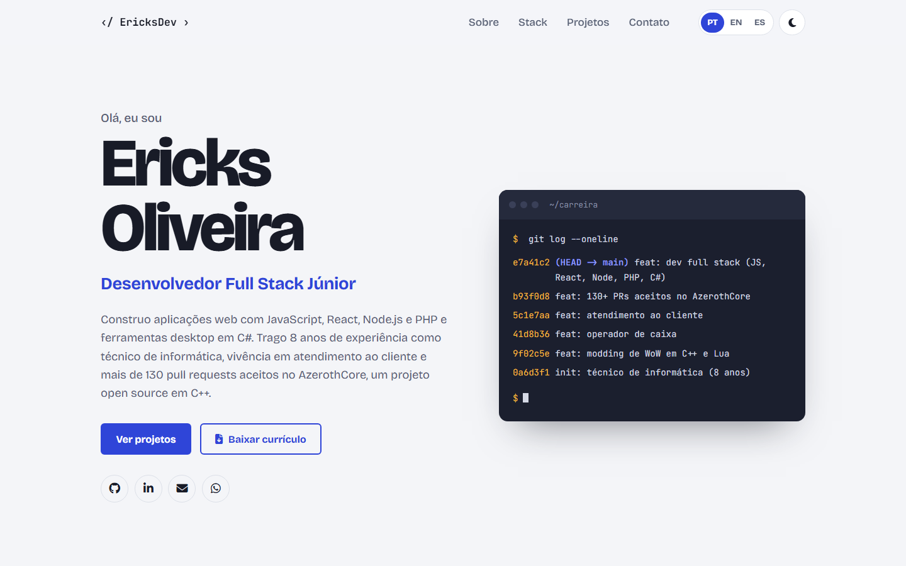

<p align="center">
  <strong>Português</strong> · <a href="README.en.md">English</a> · <a href="README.es.md">Español</a>
</p>

<h1 align="center">Portfólio | Ericks Oliveira</h1>

<p align="center">
  Site pessoal com minha trajetória, stack, projetos e formas de contato.<br>
  Feito com HTML, CSS e JavaScript puros, em três idiomas e com tema claro e escuro.
</p>

<p align="center">
  <a href="https://ericksoliveira.github.io/portfolio/"><strong>Acessar o site »</strong></a>
</p>

<p align="center">
  
  
  
  
  
</p>

<p align="center">
  <picture>
    <source media="(prefers-color-scheme: dark)" srcset="img/readme/dark.png">
    
  </picture>
</p>

## Sumário

- [Sobre mim](#sobre-mim)
- [Destaques do site](#destaques-do-site)
- [Projetos em destaque](#projetos-em-destaque)
- [Tecnologias](#tecnologias)
- [Acessibilidade](#acessibilidade)
- [Estrutura do projeto](#estrutura-do-projeto)
- [Como rodar localmente](#como-rodar-localmente)
- [Como editar textos e traduções](#como-editar-textos-e-traduções)
- [Contato](#contato)

## Sobre mim

Sou desenvolvedor Full Stack Júnior em transição de carreira, com 8 anos de experiência como técnico de informática e vivência em atendimento ao cliente. Construo aplicações web com JavaScript, React, Node.js e PHP e ferramentas desktop em C#.

Contribuo com o [AzerothCore](https://github.com/azerothcore/azerothcore-wotlk), emulador open source de World of Warcraft em C++, onde já tive **mais de 130 pull requests aceitos**.

## Destaques do site

- **Trajetória como `git log`:** a carreira aparece no topo da página como um histórico de commits num terminal.
- **Três idiomas:** português, inglês e espanhol, trocados na hora e sem recarregar a página. O idioma escolhido fica salvo no navegador.
- **Currículo por idioma:** o botão "Baixar currículo" entrega o PDF no idioma que está na tela.
- **Tema claro e escuro:** segue a preferência do sistema e pode ser trocado por um botão. A escolha também fica salva.
- **Formulário de contato:** envia e-mail pelo [FormSubmit](https://formsubmit.co/) e informa em qual idioma a pessoa escreveu.
- **Responsivo:** layout pensado para celular, tablet e desktop, com menu próprio para telas pequenas.
- **Prévia ao compartilhar:** metatags Open Graph e Twitter Card para o link aparecer com foto e descrição no LinkedIn e no WhatsApp.

## Projetos em destaque

| Projeto | O que é | Tecnologias |
| --- | --- | --- |
| [AzerothCore](https://github.com/azerothcore/azerothcore-wotlk/pulls?q=is%3Apr+is%3Amerged+author%3AEricksOliveira) | Mais de 130 PRs aceitos no emulador oficial, corrigindo magias, combate, chefes de raide e dados do jogo | C++, SQL, Lua |
| [Robô Trader](https://github.com/EricksOliveira/robo-trader) | Robô de trading para a Binance com painel, backtest e estratégias. Roda na testnet | Python, pandas, JavaScript |
| [AzerothCore CPanel](https://github.com/EricksOliveira/AzerothCore-CPanel) | Painel para Windows que controla um servidor AzerothCore, mostra logs ao vivo e faz backup | C#, WPF, .NET 8, MySQL |
| [mod-killstrike](https://github.com/EricksOliveira/mod-killstrike) | Módulo que conta sequências de abates em PvP, anuncia marcas e dá recompensas | C++, SQL |
| [mod-playerbots](https://github.com/liyunfan1223/mod-playerbots) | Módulo que adiciona bots com comportamento de jogadores reais | C++ |

Os outros projetos estão no [meu GitHub](https://github.com/EricksOliveira?tab=repositories).

## Tecnologias

| Área | Uso no site |
| --- | --- |
| HTML5 | Marcação semântica, metatags de SEO e prévia em redes sociais |
| CSS3 | Variáveis para os temas, Grid, Flexbox e media queries |
| JavaScript | Puro, sem frameworks nem bibliotecas: tema, menu, traduções e navegação ativa |
| Fontes e ícones | [Bricolage Grotesque e JetBrains Mono](https://fonts.google.com/) e [Font Awesome](https://fontawesome.com/) |
| Formulário | [FormSubmit](https://formsubmit.co/) |
| Hospedagem | [GitHub Pages](https://pages.github.com/) |

## Acessibilidade

- Navegação completa por teclado, com foco visível e tecla <kbd>Esc</kbd> para fechar o menu
- Textos alternativos nas imagens, também traduzidos
- Rótulos em todos os campos do formulário e `aria-label` nos botões de ícone
- Respeita a preferência do sistema por tema escuro e por menos animações

## Estrutura do projeto

```text
portfolio/
├── index.html      # Página única, com os textos em português
├── css/
│   └── style.css   # Estilos, temas claro e escuro e layout responsivo
├── js/
│   ├── main.js     # Tema, menu mobile e link ativo na navegação
│   └── i18n.js     # Traduções para inglês e espanhol
├── img/            # Fotos, imagens dos projetos e capturas do README
└── curriculo/      # Currículo em PDF (PT, EN e ES)
```

## Como rodar localmente

O site não precisa de build nem de dependências.

```bash
git clone https://github.com/EricksOliveira/portfolio.git
cd portfolio
```

Depois, abra o `index.html` no navegador. Se preferir um servidor local, use uma das opções:

```bash
# Python
python -m http.server 8000

# Node.js
npx serve .
```

E acesse `http://localhost:8000` (ou o endereço mostrado pelo `serve`). A extensão Live Server do VS Code também funciona.

## Como editar textos e traduções

- O **português** é o idioma padrão e fica escrito direto no `index.html`.
- O **inglês** e o **espanhol** ficam em `js/i18n.js`.
- Cada texto traduzível tem um atributo `data-i18n="chave"` no HTML. Para atributos como `alt` e `aria-label`, o atributo é `data-i18n-attr="alt:chave"`.
- Para traduzir um texto novo, coloque o atributo no elemento e adicione a mesma chave nos blocos `en` e `es` do `i18n.js`.

## Contato

- LinkedIn: [linkedin.com/in/ericksoliveira](https://www.linkedin.com/in/ericksoliveira)
- E-mail: ericksoliveira258@gmail.com
- GitHub: [@EricksOliveira](https://github.com/EricksOliveira)
